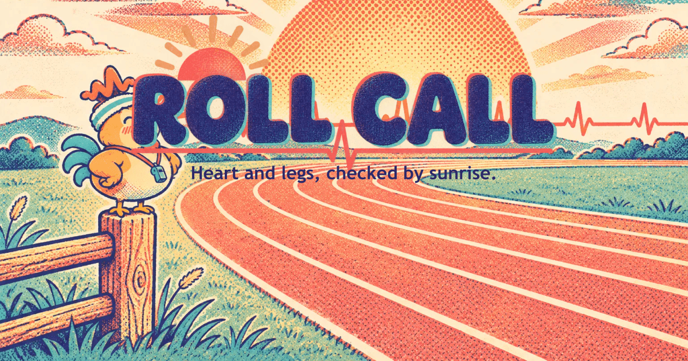

# Roll Call



**Heart and legs, checked by sunrise. No wearable, just your phone.**

**The fitness competition where resting can win.**

A complete daily system for athletes and their coaches: a morning check powered by the [Presage SmartSpectra SDK](https://github.com/Presage-Security/SmartSpectra), a jump test and training partner powered by [MediaPipe Pose](https://developers.google.com/edge/mediapipe/solutions/vision/pose_landmarker), and a team game that rewards smart decisions.

> **Not a medical device.** Readings are wellness estimates to help with training decisions, for adults 18+. The coach makes every decision. Presage states that SDK metrics are for general wellness and informational purposes and have not been cleared by the FDA.

## The problem

A coach with twelve athletes has a phone full of "feeling 6/10 I guess". Wearables cost money, need charging, and half the squad forgets them.

## How it works

1. **The athlete checks in.** A private link, a phone propped up, 75 still seconds and two taps. The sun rises as the progress bar, and the horizon is their live pulse waveform.
2. **The coach sees the board.** Everyone sorted by how far they are from their own usual, with plain reasons like "Pulse 10 above usual · HRV 36% below usual".
3. **The coach decides and sends.** Keep the plan or swap it. AI drafts a note from the numbers only, the coach edits it, and nothing goes until they press Send.

*The coach decides, the AI only drafts, and the camera only measures.*

## The daily system

| When | What | Tool |
|---|---|---|
| Morning, seated | **Heart:** pulse, breathing, HRV | SmartSpectra |
| Morning, standing | **Legs:** 3 jumps give leg freshness against your own usual, with a balance-test alternative and a skip option | MediaPipe Pose |
| Then | **Today's call:** "Heart: Ready · Legs: 9% below usual", Rollo's suggestion, and your choice | Rules in `packages/readiness` |
| Workout | **Train mode:** reps, gentle form cues, rep speed, and a "That's the set" suggestion for 7 exercises | MediaPipe Pose |
| After | **Settle check** | SmartSpectra |
| Every day | **Crews:** points for smart decisions light up a shared Dawn Map | `packages/crews` |

### Why two tools: still and moving

Camera vital signs need you still, seated and quiet, so SmartSpectra owns the seated moments. It isn't meant for movement. Pose tracking is the opposite: it needs you moving and works in the browser. So each is used where it works best, and the heart check always comes first, because jumping raises the pulse.

### The jump-height method and its limits

Height comes from flight time, h = g·t²/8, with take-off and landing interpolated between frames and hip rise as a cross-check. Tucked knees (which fake extra flight), hands off hips and leaving the frame are rejected. Even so, at 30 fps one frame is about 15% of jump height. So Roll Call **never shows centimetres as fact**: only change against your own usual, with a typical-error note. It's untested on real bodies so far. Details: [docs/MEDIAPIPE_NOTES.md](docs/MEDIAPIPE_NOTES.md).

### Why Crews scores decisions, not performance

Nobody is ranked on pulse, HRV, jump height, reps, weight or speed, so everyone starts equal. Points come from how you respond to your own readings: +3 for going hard on a Ready day or easing off on an off day, +2 for doing what you chose. Going hard on a Check in day earns nothing, with no penalty. Each day a crew's mean points spread sunrise light across a hex valley. Contested tiles go to the crew with more points that day, and light fades slowly if a crew stops checking in. Scoring happens only on the server, in an append-only ledger, and tests prove crew endpoints return no vitals or performance data. Rest days keep streaks alive, and your camp never shrinks.

## Try it

You need Node 22+ and pnpm (`npm i -g pnpm`).

```bash
pnpm install
pnpm dev        # then open http://localhost:5173
```

### Judge Mode

Press **Follow Amara's morning**. It needs no camera, no account and no keys. You get Amara's account, with a replayed heart check-in, replayed jumps and sets, four crews mid-season, and 28 days of invented history, all labelled **DEMO DATA**. Her smart call wins the contested tile. **See the coach's board** opens the coach's side. It never opens a camera, starts the SDK or calls an LLM. The movement in replays is a generated stick figure, not a person.

### Live check-ins

```bash
pnpm vitals:setup      # downloads the SDK, about 390 MB
cp .env.example .env   # then add SMARTSPECTRA_API_KEY and COACH_PASSPHRASE
pnpm dev
```

Sign in at `/coach`, add an athlete and open their link. Chrome and Edge are tested. Safari has a fallback capture path that has only been exercised in Chromium. A stable connection matters, because the SDK contacts Presage during a session. Phones need HTTPS for camera access, so use a deployment or an HTTPS tunnel, not a plain LAN address.

`/record` saves reference sessions to `data/sessions/` as numbers only, in development. Real recordings replace the synthetic stand-ins automatically. `/record-pose` downloads landmark sessions to put in `apps/web/public/poses/`.

The Legs check and Train mode need no key. On first use, the browser downloads the MediaPipe runtime and model from their CDNs.

## How each SDK signal is used

| SDK signal | Field | In Roll Call |
|---|---|---|
| Pulse rate | `cardio.pulseRate` | Readiness, weight 0.24, against the athlete's own usual |
| HRV (RMSSD) | `cardio.hrv[].rmssd` | Readiness, weight 0.20, compared on a log scale |
| Baevsky stress index | `cardio.hrv[].baevsky` | Readiness, weight 0.12, only against their own usual |
| SDNN, mean NN | `cardio.hrv[].sdnn`, `.meanNn` | Stored and exported |
| Breathing rate | `breathing.rate` | Readiness, weight 0.12 |
| Pulse waveform | `cardio.arterialPressureTrace` | The live horizon. Arbitrary units, shape only |
| Breathing waveform | `breathing.upperTrace` | The sun's breathing glow |
| Talking | `face.talking` | Pauses the check-in, and those readings don't count |
| Validation status | `validationStatus` | Friendly framing hints from Rollo |
| Confidence | On each metric | Below the SDK's gates, a metric is "not read today" |

Sleep (0.08) and how they feel (0.04) are the athlete's own answers. Jump height (0.20) comes from MediaPipe and counts after 5 valid Legs checks. Weights renormalise when something's missing, so someone who never jumps scores as if jump weren't there. Sources and caveats: [docs/SDK_NOTES.md](docs/SDK_NOTES.md).

## The readiness model

- **Learning:** no status until 5 good check-ins.
- **Baseline:** rolling 14-day median and MAD, from good check-ins only.
- **Deviation:** robust z-score, with a floor so tiny spreads can't explode, counting only the "harder day" direction.
- **Status:** Watch if the combined score is at least 1 or one metric at least 2. Check in if combined is at least 2, or after Watch 3 days running. Statuses hold near a threshold so they don't flicker.
- **Missing data:** low-confidence metrics drop out and the weights renormalise.

Status is a shape and text as well as a colour: sun up, sun rising, sun behind a cloud, moon.

## Architecture

```
athlete browser ── frames ──▶ apps/api ── one process per session ──▶ apps/vitals-worker (SDK)
                ◀─ waveform ─┤   │
coach browser  ◀── REST ─────┘   ├─ packages/readiness  baselines, status, check-in logic (pure)
                                 ├─ packages/drafts     LLM adapters, wording filter, templates
                                 ├─ packages/crews      points, Dawn Map, seasons, camps (pure)
                                 └─ packages/db         SQLite through Drizzle

athlete browser ── MediaPipe Pose, on the phone ── packages/pose (jumps, reps, form; pure)
                └─ only derived numbers go to apps/api. Pose frames never leave the device.
```

More in [docs/ARCHITECTURE.md](docs/ARCHITECTURE.md). Choices and alternatives: [docs/DECISIONS.md](docs/DECISIONS.md).

## Privacy

- **Video is never saved.** Heart check-in frames are processed in memory on the Roll Call server and discarded. Only derived numbers are stored.
- **Pose frames never leave the phone.** Legs and Train run MediaPipe in the browser and send only jump and rep numbers. The browser downloads the runtime and model from jsDelivr and Google's storage. MediaPipe also tries to send Google usage metrics (no images or landmarks), and a Content-Security-Policy blocks that.
- **Crews never see readings.** Teammates see whether you've checked in, and your points and streak if you allow it. A low mood streak shows only to you.
- **What leaves the server:** the SDK contacts Presage to check its key and usage and to load its models. SDK telemetry is turned off, and its cloud LLM feature is never called.
- **What AI sees:** numbers and the coach's chosen action. Never names, video, notes or session titles.
- **Athletes' control:** export or delete everything from their own page. Deleting ends their link.
- **Coaches** see only their own athletes, and links are unguessable and can be rotated.

## Honesty and limits

- Pulse is validated for 40–110 bpm and breathing for 5–40 per minute. Roll Call never reports pulse above that range.
- Readings are estimates and a status is not a verdict. Pulse also moves with coffee, poor sleep or a stressful commute.
- Coach sign-in is a shared passphrase, which suits a hackathon, not production.
- **Bundled sessions are synthetic**, generated by `tools/seed/gen-sessions.ts` and `tools/seed/gen-poses.ts` and labelled, until real recordings replace them. So every threshold for jumps, reps and form is untested on real bodies.
- **Jump and rep numbers come from the phone.** The server recomputes height from flight time and limits the range, but can't verify a pose it never sees. Legs points only need a completed check, so faking one gains one point at most. The heart point can't be faked this way, because that reading is taken on the server.
- Rep speed and form cues are for training feedback only. Stop if anything hurts. Skip the jumps if you're sore or injured.

## Development

```bash
pnpm test           # unit and contract tests
pnpm test:e2e       # Playwright, desktop and phone. First run: pnpm --filter @rollcall/web exec playwright install chromium
pnpm typecheck
pnpm lint
pnpm sessions:gen   # rebuild synthetic heart sessions
pnpm poses:gen      # rebuild synthetic pose sessions
pnpm assets:forge   # generate art with OpenAI. Has a spend guard: ASSET_MAX_USD, default 2
pnpm assets:brand   # rebuild icons and share images, free
```

To deploy: `Dockerfile` and `render.yaml` run Judge Mode. Build with `--build-arg WITH_SDK=1` for live check-ins, and read [Presage's terms](https://physiology.presagetech.com/tos) first.

## Credits

- [Presage SmartSpectra SDK](https://github.com/Presage-Security/SmartSpectra) for the measurement. Integration follows its documentation.
- [MediaPipe Tasks Vision](https://developers.google.com/edge/mediapipe/solutions/vision/pose_landmarker) for pose landmarks. Apache-2.0.
- One Euro filter after Casiez, Roussel and Vogel, CHI 2012.
- [React](https://react.dev), [Vite](https://vite.dev), [Tailwind CSS](https://tailwindcss.com), [Motion](https://motion.dev), [Recharts](https://recharts.org), [Hono](https://hono.dev), [Drizzle](https://orm.drizzle.team), [libSQL](https://github.com/tursodatabase/libsql), [zod](https://zod.dev), [ws](https://github.com/websockets/ws), [sharp](https://sharp.pixelplumbing.com), [Vitest](https://vitest.dev), [Playwright](https://playwright.dev), [axe](https://github.com/dequelabs/axe-core).
- Illustrations generated with the OpenAI API. Prompts are in `assets/manifest.json`. Every athlete is fictional.

Built for the [Presage SmartSpectra SDK Challenge](https://dev.to/devteam/join-the-presage-smartspectra-sdk-challenge-3000-in-prizes-across-10-winners-1370) on DEV.
