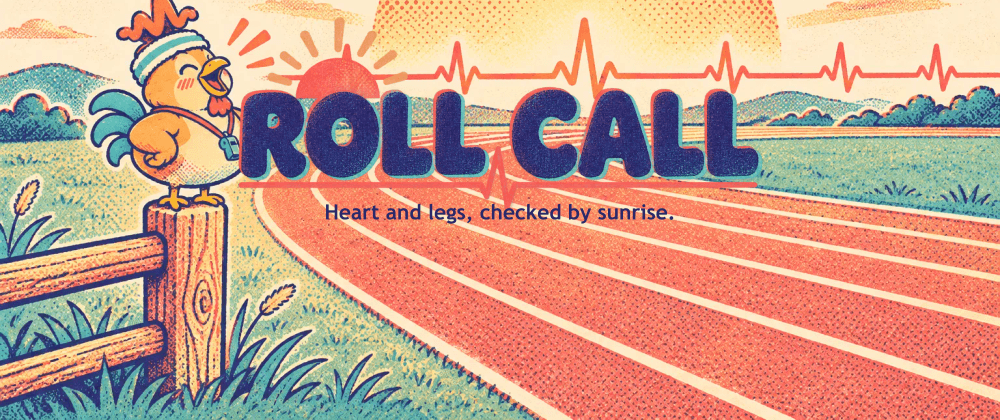
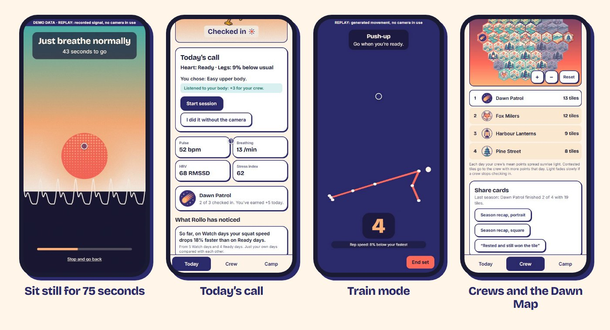
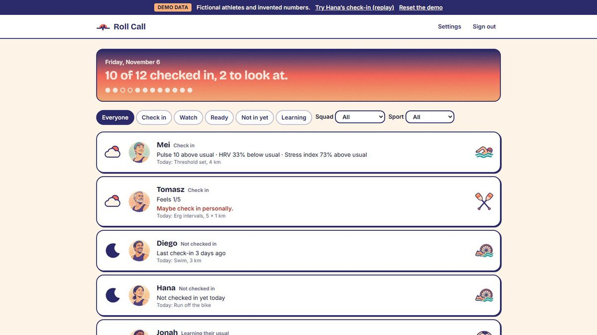
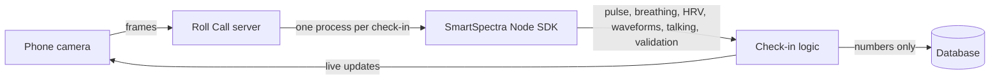

# Roll Call



**Should you train hard today, or take it easy?** Roll Call answers that with 75 seconds in front of a phone camera. No wearable.

It reads your pulse, breathing and heart rate variability with the [Presage SmartSpectra SDK](https://github.com/Presage-Security/SmartSpectra), compares them with your own last two weeks, and helps you make the call. Built for the [Presage SmartSpectra SDK Challenge](https://dev.to/challenges/presage-2026-11-04) on DEV.

> **Not a medical device.** Readings are wellness estimates to help with training decisions, for adults 18+. You make every decision. Presage states that SDK metrics are for general wellness and informational purposes and have not been cleared by the FDA.

## Watch the walkthrough

<!-- When the video is up, wrap this image in a link to it: [](https://youtu.be/...) -->


## Try it in two minutes

No camera, no account and no API keys needed. You need Node 22+ and pnpm (`npm i -g pnpm`).

```bash
git clone https://github.com/Bin4yi/RollCall.git
cd RollCall
pnpm install
pnpm dev
```

Open http://localhost:5173 and press **Follow Amara's morning**. Everything in this mode is fictional and labelled **DEMO DATA**. It replays recorded signals and never opens a camera, starts the SDK or calls an AI service. The movement in replays is a generated stick figure, not a person. **See the coach's board** opens the coach's side.

## What it does



| When | What happens | Powered by |
|---|---|---|
| Morning, seated | **Heart:** 75 still seconds, with a sun rising as it reads | **Presage SmartSpectra** |
| Morning, standing | **Legs:** three jumps against your own usual, a balance test instead, or skip | MediaPipe Pose |
| Before training | **Today's call:** "Heart: Ready · Legs: 9% below usual", with a suggestion you can ignore | Personal baselines |
| During training | **Train:** rep counts, gentle form cues, and a nudge when rep speed drops | MediaPipe Pose |
| After training | **Settle check:** a 60-second reading | **Presage SmartSpectra** |
| Every day | **Crews:** a team game that scores smart decisions and never vitals | Server-side points |

**Coaches** get one board, with everyone sorted by how far they are from their own usual. AI drafts a note from the numbers, and nothing is sent until the coach presses Send.



## How the Presage SmartSpectra SDK is used



The app supplies its own frames through the SDK's custom input, in [`apps/vitals-worker/src/worker.ts`](apps/vitals-worker/src/worker.ts):

```js
const sdk = new mod.SmartSpectraSDK({
  apiKey,
  enableTelemetry: false,
  requestedMetrics: [...mod.breathingMetrics, ...mod.cardioMetrics, ...mod.faceMetrics],
});
sdk.useCustomInput();
sdk.start();
sdk.sendFrame(buf, w, h, stride, fmt, ts);
```

| SDK signal | Field | What it does in Roll Call |
|---|---|---|
| Pulse rate | `cardio.pulseRate` | Readiness, weight 0.24, against your own usual |
| HRV (RMSSD) | `cardio.hrv[].rmssd` | Readiness, weight 0.20, compared on a log scale |
| Baevsky stress index | `cardio.hrv[].baevsky` | Readiness, weight 0.12, only against your own usual |
| Breathing rate | `breathing.rate` | Readiness, weight 0.12 |
| SDNN, mean NN | `cardio.hrv[].sdnn`, `.meanNn` | Stored and exported |
| Pulse waveform | `cardio.arterialPressureTrace` | The moving horizon on the check-in screen. Shape only |
| Breathing waveform | `breathing.upperTrace` | The sun's glow |
| Talking | `face.talking` | Pauses the check-in, and those readings don't count |
| Validation status | `validationStatus` event | Friendly hints, like "Find some light in front of you" |
| Confidence | On each metric | Below the SDK's gates, a metric says "not read today" and is never guessed |

Sleep (0.08) and how you feel (0.04) are your own answers. Jump height (0.20) comes from MediaPipe and only counts after 5 valid Legs checks. Weights renormalise when something's missing, so someone who never jumps scores as if jump weren't there.

**How the SDK shaped the product:**

- **75 seconds,** because HRV needs a full 60-second window.
- **Personal baselines,** because Presage's docs say to read the stress index against the same person's baseline.
- **30 fps,** because the docs warn against dropping below about 25.
- **Two tools,** because camera vitals need you still. MediaPipe handles jumps and reps, and the heart check always comes first, because jumping raises the pulse.

Sources, caveats and open questions: [docs/SDK_NOTES.md](docs/SDK_NOTES.md).

## How the decisions work

**Readiness.** No status until 5 good check-ins. After that, each reading is compared with your rolling 14-day median using a robust z-score. You see Watch if the combined score is at least 1 or one metric at least 2, and Check in if the combined score is at least 2 or after Watch 3 days running. Status is a shape and words as well as a colour.

**Jump height.** Height comes from flight time, h = g·t²/8, with take-off and landing interpolated between frames and hip rise as a cross-check. Tucked landings, hands off hips and leaving the frame get rejected. At 30 fps one frame is still about 15% of the height, so Roll Call never shows centimetres, only the change against your own usual. Details: [docs/MEDIAPIPE_NOTES.md](docs/MEDIAPIPE_NOTES.md).

**Crews.** Nobody is ranked on pulse, HRV, jumps, reps, weight or speed. You earn +3 for going hard on a Ready day or easing off on an off day, and +2 for doing what you chose. Going hard on a Check in day earns nothing, with no penalty. A crew's mean points spread light across a hex map, contested tiles go to the crew with more points that day, and rest days keep streaks alive. Scoring happens only on the server, in an append-only ledger.

## Run a live check-in

```bash
pnpm vitals:setup      # downloads the SDK, about 390 MB
cp .env.example .env   # add SMARTSPECTRA_API_KEY, COACH_PASSPHRASE and SESSION_SECRET
pnpm dev
```

Sign in at `/coach`, add an athlete and open their link. Sit with light in front of you and your head and upper chest in view, on a steady connection, because the SDK contacts Presage during a session. Chrome and Edge are tested. Phones need HTTPS for camera access, so use a deployment or an HTTPS tunnel.

`/record` saves reference sessions as numbers only, in development. `/record-pose` downloads landmark sessions to put in `apps/web/public/poses/`.

## Privacy

- **Heart check-in video is never saved.** It's processed in memory on the Roll Call server and thrown away. Only numbers are kept.
- **Legs and Train video never leaves the phone.** MediaPipe runs in the browser, and only jump and rep numbers are sent.
- **Crews never see readings:** only whether you've checked in, plus points and streaks if you allow it. A low mood streak shows only to you.
- **What leaves the server:** the SDK contacts Presage to check its key and usage and to load its models. SDK telemetry is off, and its cloud insight feature is never called.
- **AI drafts** see numbers and the coach's chosen action, never names, video or notes.
- **MediaPipe:** the browser downloads it from jsDelivr and Google. The library also tries to send Google usage metrics, with no images or landmarks, and a Content-Security-Policy blocks that.
- **You're in control:** download or delete everything from your own page. Deleting ends your link.

## Current status and limits

| Area | Status |
|---|---|
| Judge Mode, coach board, Crews, Dawn Map, points | Working, with tests |
| SmartSpectra path | Runs through the whole app. **Real-person readings are still being validated**, so bundled sessions and thresholds are synthetic and labelled |
| Jumps, squats, goblet squats, push-ups, balance | Work on real MediaPipe landmarks from AI-generated test clips. Accuracy on real bodies isn't proven |
| Lunges, glute bridges, overhead press | **Don't count properly on real landmarks yet** |
| Knees-caving and hip-sag cues | **Not firing on real landmarks yet** |
| Real phones and Safari | Not tested yet |

Also worth knowing:

- Pulse is validated for 40–110 bpm and breathing for 5–40 per minute. Roll Call doesn't report pulse outside that range.
- Readings are estimates. Pulse also moves with coffee, poor sleep or a stressful commute.
- Jump and rep numbers come from the phone, so they could be faked, for 1 point at most. The heart point can't, because that reading is taken on the server.
- Coach sign-in is a shared passphrase, which suits a hackathon rather than production.
- Stop if anything hurts, and skip the jumps if you're sore or injured.

## Project layout

```
apps/web             React app: landing, athlete, coach, pose capture
apps/api             Hono API, check-in sockets, season job
apps/vitals-worker   One SmartSpectra session per process
packages/readiness   Baselines, status, check-in rules, today's call, insights
packages/pose        Jump, rep and balance analysis
packages/crews       Points, Dawn Map, seasons, camps
packages/signals     Common signal format, replay and simulation
packages/db          Schema, queries and demo story
packages/drafts      AI draft adapters, with templates as the fallback
```

More in [docs/ARCHITECTURE.md](docs/ARCHITECTURE.md). Choices and alternatives are in [docs/DECISIONS.md](docs/DECISIONS.md).

## Development

```bash
pnpm test           # unit and contract tests
pnpm test:e2e       # Playwright, desktop and phone. First run: pnpm --filter @rollcall/web exec playwright install chromium
pnpm typecheck
pnpm lint
pnpm sessions:gen   # rebuild synthetic heart sessions
pnpm poses:gen      # rebuild synthetic pose sessions
pnpm assets:forge   # generate art with OpenAI. Spend guard: ASSET_MAX_USD, default 2
pnpm assets:brand   # rebuild icons and share images, free
```

To deploy: `Dockerfile` and `render.yaml` run Judge Mode. Build with `--build-arg WITH_SDK=1` for live check-ins, and read [Presage's terms](https://physiology.presagetech.com/tos) first.

## Credits

- [Presage SmartSpectra SDK](https://github.com/Presage-Security/SmartSpectra) for the measurement. Integration follows its documentation.
- [MediaPipe Tasks Vision](https://developers.google.com/edge/mediapipe/solutions/vision/pose_landmarker) for pose landmarks. Apache-2.0. One Euro filter after Casiez, Roussel and Vogel, CHI 2012.
- [React](https://react.dev), [Vite](https://vite.dev), [Tailwind CSS](https://tailwindcss.com), [Motion](https://motion.dev), [Recharts](https://recharts.org), [Hono](https://hono.dev), [Drizzle](https://orm.drizzle.team), [libSQL](https://github.com/tursodatabase/libsql), [zod](https://zod.dev), [ws](https://github.com/websockets/ws), [sharp](https://sharp.pixelplumbing.com), [Vitest](https://vitest.dev), [Playwright](https://playwright.dev), [axe](https://github.com/dequelabs/axe-core).
- Illustrations generated with the OpenAI API. Prompts are in `assets/manifest.json`. Every athlete is fictional.
